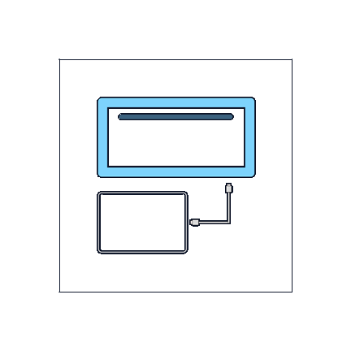
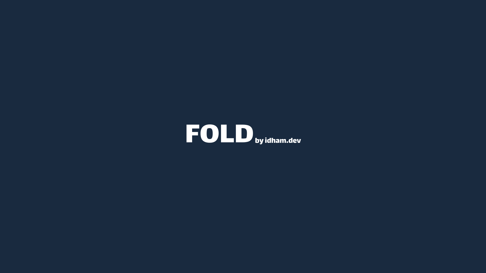
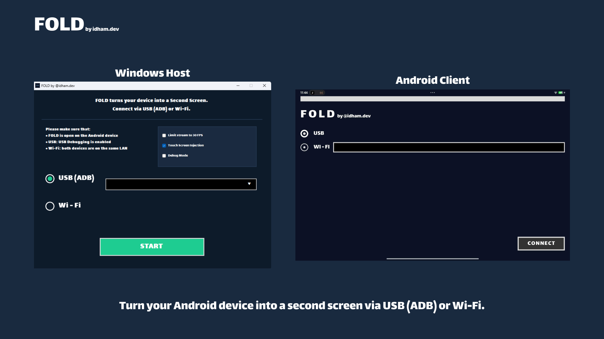
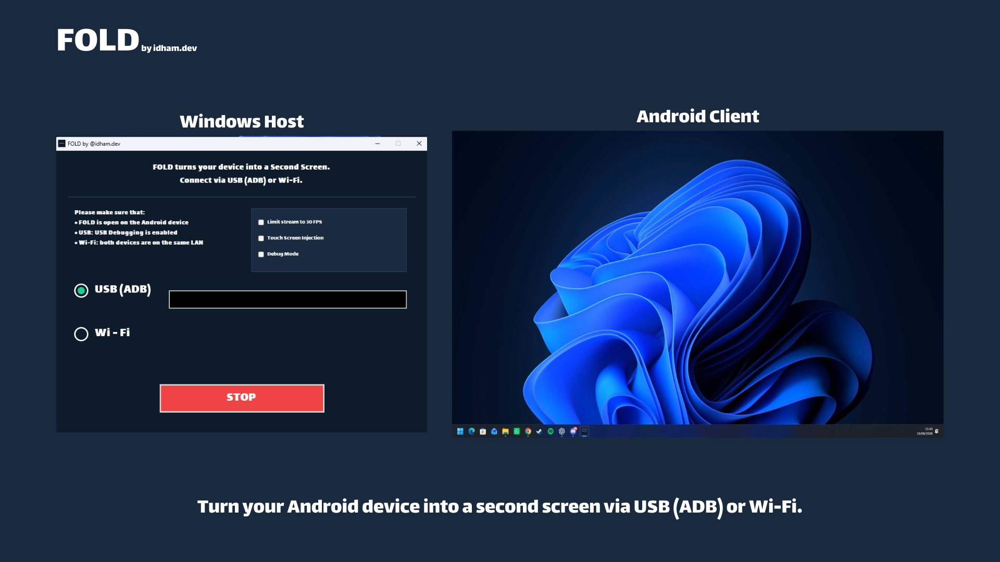

<div align="center">



# FOLD

**Fast Operational Link Display**

**Turn an Android tablet into an extended display for a Windows PC.**

Free to use, works offline, and no account is required.

[](https://github.com/idhamdotdev/FOLD/releases/latest)
[](EULA.md)
[](PRIVACY.md)

</div>

---

FOLD creates a virtual monitor, encodes it as H.264, renders it on Android,
and can send touch input back to Windows over USB or trusted local Wi-Fi. No
cloud relay or root access is required.

## Platform support

- **Windows 11 x64:** officially supported target.
- **Windows 10 22H2 x64:** experimental/best-effort. The same build may work,
  but compatibility, fixes, and performance are not guaranteed.
- **Android 8.0 or newer:** Android client target, no root required.

## Features

| | |
| --- | --- |
| **Real extended desktop** | Creates a separate Windows display through the bundled Virtual Display Driver instead of mirroring the primary monitor. |
| **Wi-Fi and USB streaming** | Sends H.264 video over a trusted local network or an ADB USB connection. |
| **Multi-device USB selection** | Selects the intended authorized Android device when several ADB devices are connected. |
| **Hardware-preferred encoding** | Uses a compatible Media Foundation hardware encoder when available, with the Microsoft inbox encoder as fallback. |
| **Android hardware decoding** | Renders the stream through Android MediaCodec and a Surface. |
| **Touch input** | Optionally maps Android touch input back to the Windows virtual display. |
| **Practical session controls** | Includes a 30 FPS limiter, debug overlay, automatic reconnection, and tray controls. |
| **Private by design** | Requires no account, subscription, advertising, cloud processing, or developer-operated relay. |

<div align="center">



</div>

## Connection setup

<div align="center">



</div>

## Extended display in use

<div align="center">



</div>

## Start here

| Need | Document |
| --- | --- |
| Install and connect | [Getting started](docs/GETTING-STARTED.md) |
| Fix common problems | [Troubleshooting](docs/TROUBLESHOOTING.md) |
| Understand local data | [Privacy notice](PRIVACY.md) |
| Understand network risk | [Security policy](SECURITY.md) |
| Check release/support status | [Project status](docs/PROJECT-STATUS.md) |
| Verify a download | [Verification guide](docs/VERIFYING-DOWNLOADS.md) |
| Get product help | [Open a bug report or feature request](https://github.com/idhamdotdev/FOLD/issues/new/choose) |

## Quick start

1. Download `FOLD_setup.exe` from the official release page. Install the
   matching Android app from the same release or from the official Google Play
   listing when available.
2. Install the Windows host and approve driver installation.
3. Install and open the Android APK.
4. For USB, enable USB debugging, accept the PC fingerprint, choose the tablet
   in FOLD's ADB selector, then press **START** on Windows and **CONNECT** on
   Android.
5. For Wi-Fi, place both devices on one trusted private network, select
   **Wi-Fi**, copy the PC IP into Android, press **START**, then **CONNECT**.

FOLD creates an extended monitor, not a mirror. Move a Windows app onto the
virtual display to show it on the tablet.

## Support

For installation, connection, or compatibility problems, use the
[troubleshooting guide](docs/TROUBLESHOOTING.md) first, then open a
[GitHub issue](https://github.com/idhamdotdev/FOLD/issues/new/choose) with the
FOLD version, Windows and Android versions, and connection mode. Do not post
screen content, ADB keys, passwords, private IP addresses, or other sensitive
data in a public issue. Security reports belong in the private channel
described in [SECURITY.md](SECURITY.md). For direct product support, contact
[hello@idham.dev](mailto:hello@idham.dev).

## Security and privacy

Video and touch data travel directly between the selected Windows PC and
Android device. FOLD has no product telemetry or cloud relay. It does keep
small local preferences and an operational log as described in
[PRIVACY.md](PRIVACY.md).

Wi-Fi transport is cleartext and does not authenticate peers. Use it only on
a trusted private network, never port-forward TCP `8765` or `8766`, and prefer
USB when the network cannot be trusted. See [SECURITY.md](SECURITY.md).

## How current FOLD works

```text
Windows virtual display
  -> Windows Graphics Capture / fallback capture
  -> Microsoft Media Foundation H.264 Encoder MFT
  -> TCP 8765 over trusted Wi-Fi or ADB forwarding over USB
  -> Android MediaCodec Surface render

Android touch
  -> TCP 8766 over trusted Wi-Fi or ADB forwarding over USB
  -> Windows input agent mapped to the virtual display
```

## License

FOLD is proprietary freeware. Personal, educational, employment, business,
and commercial use of official builds is permitted free of charge under the
[EULA](EULA.md), including use in paid work and monetized content. The EULA
does not provide or transfer source code or intellectual-property rights. The
software may not be republished, modified, sold, offered as a managed or
white-label service, or publicly redistributed except as the EULA or
applicable law permits. See the concise [licensing notice](LICENSE.md).

Third-party components retain their own terms. See
[THIRD-PARTY-NOTICES.md](THIRD-PARTY-NOTICES.md).

---

Built by [idham.dev](https://idham.dev)
